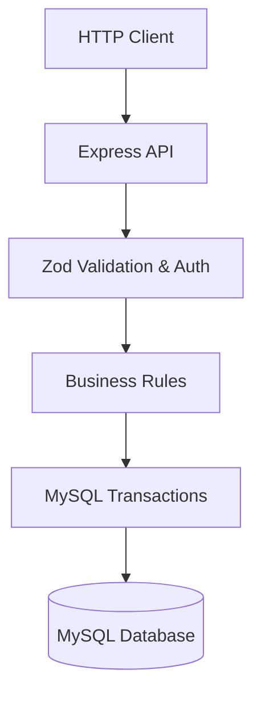

# OrderFlow API

**An order management REST API built with TypeScript, Node.js, Express, MySQL, and Docker.**

Designed as a portfolio project to demonstrate backend architecture, real-world business rules, database transactions, access control, automated tests, and deployment readiness.

> **Portfolio project:** This is an original educational implementation. It is not connected to any employer, client, or proprietary system. It does not process real payments.

## Features

- **Authentication:** user registration, login, signed JWT access tokens, password hashing with `scrypt`.
- **Role-based access:** customers can shop; administrators can create and update products.
- **Product catalog:** public listing, pagination, stock, price in integer cents, and product status.
- **Order lifecycle:** place an order, view order history, view details, and cancel an order.
- **Inventory integrity:** a MySQL transaction locks product rows before checkout and deducts stock atomically; cancellations return stock.
- **Security & quality:** Zod request validation, parameterized SQL, standardized errors, Helmet, strict TypeScript, and automated unit/API tests.
- **Reproducibility:** Docker Compose, SQL schema, environment template, and GitHub Actions CI.

## Stack

| Layer | Technology |
| --- | --- |
| Language | TypeScript (strict mode) |
| API | Node.js, Express 5 |
| Database | MySQL 8.4, `mysql2` |
| Validation | Zod |
| Authentication | `jose` JWT, Node.js `scrypt` |
| Tests | Vitest, Supertest |
| Infrastructure | Docker, Docker Compose; Cloud Run-ready container |
| CI | GitHub Actions |

## Architecture



```text
src/
  app.ts                # Express app and middleware
  server.ts             # Process entry point / graceful shutdown
  config.ts             # Validated environment configuration
  database.ts           # MySQL connection pool
  lib/                  # Errors, password hashing, JWT, Zod schemas
  middleware/           # Authentication and permissions
  routes/               # HTTP route handlers
  services/             # Order transactions and business rules
database/               # SQL schema
scripts/                # Database setup command
tests/                  # Automated tests
```

## Run with Docker

Requirements: Docker with the Compose plugin.

```bash
git clone https://github.com/bernardosampaiosousa/orderflow-api.git
cd orderflow-api
cp .env.example .env
```

Edit `.env` and replace **DB_PASSWORD**, **MYSQL_ROOT_PASSWORD**, and **JWT_SECRET** with your own strong random values. Generate the JWT secret with:

```bash
node -e "console.log(require('node:crypto').randomBytes(32).toString('hex'))"
```

Then start the API and database:

```bash
docker compose up --build -d
curl http://localhost:3000/health
```

Expected health response:

```json
{"status":"ok"}
```

The database schema is initialized automatically when the MySQL volume is first created. Existing database volumes are preserved; if you need to apply the schema manually, run `npm run db:migrate` with access to the database. **Do not delete the Docker volume to rerun migrations.**

## Run locally

With Node.js 22+ and a running MySQL database:

```bash
npm ci
cp .env.example .env
# Configure DB_* variables and JWT_SECRET in .env
npm run db:migrate
npm run dev
```

To run automated checks without a live database:

```bash
npm run check
```

## API Reference

All routes send and receive JSON. Protected routes require `Authorization: Bearer <token>`.

| Method | Path | Access | Description |
| --- | --- | --- | --- |
| GET | `/health` | Public | Database-backed health check |
| POST | `/api/auth/register` | Public | Create a customer account |
| POST | `/api/auth/login` | Public | Authenticate and receive a JWT |
| GET | `/api/auth/me` | Authenticated | Current account |
| GET | `/api/products?page=1&limit=20` | Public | Paginated active products |
| GET | `/api/products/:id` | Public | Active product details |
| POST | `/api/products` | Admin | Create a product |
| PATCH | `/api/products/:id` | Admin | Update price, stock, details, or active status |
| POST | `/api/orders` | Authenticated | Place an order |
| GET | `/api/orders?page=1&limit=20` | Authenticated | Own orders (admins see all) |
| GET | `/api/orders/:id` | Owner/Admin | Order details with price snapshot |
| POST | `/api/orders/:id/cancel` | Owner/Admin | Cancel an order and restock |

### Example: register

```bash
curl -X POST http://localhost:3000/api/auth/register \
  -H 'Content-Type: application/json' \
  -d '{"name":"Bernardo","email":"bernardo@example.com","password":"example-only-strong-password"}'
```

The response includes a `token` to send in the `Authorization` header. New registrations always receive the **CUSTOMER** role.

### Example: create a product (admin)

```json
{
  "sku": "KEYBOARD-001",
  "name": "Mechanical keyboard",
  "description": "A keyboard for developers",
  "priceCents": 12990,
  "stock": 25
}
```

### Example: place an order

```json
{
  "items": [
    {"productId": "REPLACE-WITH-REAL-PRODUCT-UUID", "quantity": 2}
  ]
}
```

The server determines the price from the database; clients **cannot** submit their own product prices or order totals.

### Administrator setup (local development only)

There is deliberately no public "register as admin" option. After registering a local test account, connect to your development MySQL database as an administrator and run:

```sql
UPDATE users SET role = 'ADMIN' WHERE email = 'bernardo@example.com';
```

In a real deployment, promotions should be handled only through a controlled administrative workflow. Log in again afterward to obtain a fresh token; active account roles are rechecked against the database on each authenticated request.

## Business Rules & Design Decisions

1. **Money is stored in cents** to avoid floating-point rounding errors.
2. **Checkout is transactional:** lock requested product records, validate availability, create the order, snapshot unit prices, and decrement stock in one transaction. Any error triggers a rollback.
3. **Concurrent checkouts cannot oversell:** InnoDB `SELECT ... FOR UPDATE` row locks and conditional stock updates protect inventory.
4. **Cancellation is idempotence-aware:** only a `PLACED` order can be cancelled. A second cancellation returns a `409` error rather than restoring stock twice.
5. **Ownership is enforced:** customers can only read or cancel their own orders.
6. **Products are deactivated, not hard-deleted,** preserving order history and references.
7. **Payloads are validated** before they reach database operations. Error responses follow a consistent JSON structure.

## Next Improvements

- Integration tests against a disposable MySQL container.
- Structured logs, metrics, and request tracing.
- Distributed rate limiting for authentication endpoints.
- Database migration version tracking.
- Automated deployment to Cloud Run with managed database credentials.

## License

MIT — see [LICENSE](LICENSE).
